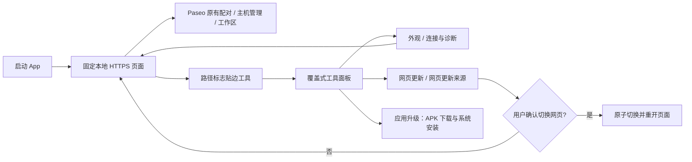
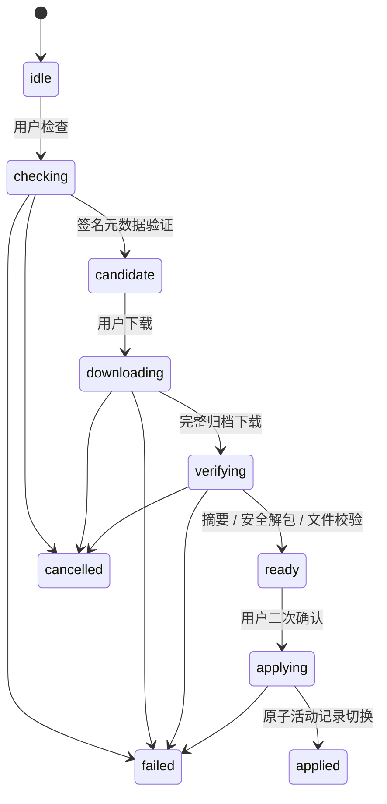

# Paseo Pocket 实现结构

## 页面与原生边界

`MainActivity` 持有一个 `WebSession` 和覆盖在其上的浮动工具。
`FloatingTool` 只处理手势、吸边及归一化位置；工具面板不持有 WebView。
路径标志侧柄沿用原有停靠偏好，仅其触控区域申请系统手势排除。
可见的 26dp 侧柄始终贴合安全区域边缘，不为手势额外向内移动。
部分旧 ROM 不上报侧向手势边距且忽略排除区域，此时仅向内扩展透明触控区；
不改变网页宽度或侧柄外观。红米实测可点击标志，从内侧触控区拖动。
`ToolSheet` 在同一底部面板中管理四格首页和设置子页；`ShellUi` 统一原生配色、字号及控件样式。
夜间模式原位重绘原生界面，子页用当前 Activity 主题创建，避免沿用旧 Dialog 的颜色。
同时更新框架 `android:isLightTheme` 与 WebView 配置，使网页颜色偏好跟随同一次切换。
主题变化由 Activity 处理配置更新，不重建网页。`BackgroundPolicy` 从 onStop 开始计时，
后台保留 30 秒运行机会，之后暂停 WebView 定时器；onStart 取消旧计时并恢复。
更换页面沿用原后台截止时间，销毁仅清理本实例计时器。onPause 停止性能采样和录制，
但不立即冻结 JavaScript。回前台通过现有连接管理验证连接。
服务端任务继续由原 Paseo 运行，App 不代替服务端调度任务。

原生容器按系统栏、刘海和 IME 计算内容范围，传给网页的已处理边距清零。
Android 10 的 DisplayCutout 对象也显式清除，避免新 WebView 再次转成 CSS 安全区。
键盘临时夹紧浮钮位置，不覆写键盘收起后的停靠位置。

`WebBundle` 仅把清单中的静态文件映射到 `appassets.androidplatform.net`。
SPA 工作区路由映射到入口 HTML，其他缺失资源返回 404。无静态资源的官网回源。
`PageOrigin` 约束来源、资源路径和恢复路由；恢复位置不保留 query / fragment 中的配对信息。
WebView 禁用文件 URL / 内容 URL 访问与混合内容。诊断使用限定来源和顶层页面的
WebMessageListener，仅接收白名单状态和数值，不提供文件、任务或权限操作接口。
文件选择由系统 Activity Result 返回，外链交给系统，不把 App 做成通用浏览器。

## 状态与目录

| 内容 | 位置 / 归属 |
| --- | --- |
| 内置网页与 npm 信任公钥 | APK assets，构建时生成 |
| 不可变安装包 | App 私有 files/pages/version-digest/ |
| 活动包 / 待应用记录 | 同目录 active.json / pending.json |
| 下载与解包暂存 | 同目录独占随机名称，重启可清理 |
| 配对、Cookie、IndexedDB | 系统 WebView 数据目录，更新模块不写入 |
| 外观、浮钮、来源、上次路由 | App 私有 SharedPreferences |
| 诊断事件与数值 | App 私有有界记录，最多 200 条 / 128 KiB，仅手动复制或分享 |
| APK 候选 / 待安装记录与安装包 | 私有 files/apk-updates/，AtomicFile 保存记录 |
| APK 检查开关 / 尝试与成功时间 | 独立 app_updates SharedPreferences |
| 签名密钥 | 开发机私有目录，不进入源码和 APK |

网页版本固定来源使更新不改变配对存储来源。保留上一完整文件集，但不自动回滚网页数据。

## 观察与连接恢复

`observation/` 分离消息校验、阶段计时、按需采样和原生界面。
独立的 APK 脚本观察已验证的 0.12.0 `__paseoHostRuntimeStore`；成功订阅后没有常驻查询循环。
未知网页版本或能力缺失退回原生加载／生命周期指标，诊断故障不接管页面恢复。
脚本不接触 DOM、CSS 和页面组件，也不替换 WebSocket、fetch 或网页处理函数。
每个文档使用独立挑战与序号，旧页面消息、非顶层来源、超大或过量消息均被丢弃。
读取心跳 RTT 时保存“观察时间”，不伪造上游没有提供的测量时间。

`ConnectionTrace` 使用单调时钟记录观察区间，区分启动／恢复总耗时与连接、同步阶段。
首次看到主机时可能已经在线，不能把之前的页面停留时间算成连接时间。
每次恢复仅调用已有验证入口；忙碌时合并操作，观察验证结果的短期查询有明确截止时间。
不创建替代连接，不刷新整页，不发送任务消息。

CPU／流量 2 秒、PSS 5 秒，由单个工作线程执行，旧结果按代号丢弃。
性能查看和最多 60 秒的前台录制共同决定采样开关；长期后台不采样。
长任务观察仅按需注册，并将高频记录合并；原生文本仅在变化时重新设置。
日志只接收事件代码与数值白名单，加载旧日志时再次校验；不记录主机地址、内容或凭据。
原生进程或 WebView 渲染进程退出均不触发任何会话投递；用户手动重开后检查原会话状态。

## 更新状态机与信任

`appupdates/` 单独处理 APK 更新：`AppReleasePolicy` 筛选混合 GitHub 发布与清单，
`AppUpdateClient` 分页查找及下载，`ApkTrust` 通过摘要及 Android 包管理器核对包和签名身份，
`AppUpdates` 拥有单个工作线程、24 小时前台检查、缓存候选版本及持久待安装包，`AppUpdateUi` 管理原生入口与安装确认。
四格分别为外观、网页更新、应用升级、连接与诊断，没有第五行入口或自动更新弹窗。
网页来源属于网页更新子页，保存和返回先回网页更新，再回工具首页。
`UpdateGate` 按操作代号互斥两套更新；终态和销毁释放自己的代号，旧完成回调不能释放新操作。
自动 APK 检查遇到网页更新忙碌时跳过；离开前台取消自动检查，手动下载仅在现有进程内继续。
后台工作和已移除视图通过代号、解绑及关闭检查隔离。元数据与文件摘要在工作线程处理。
候选版本与待安装记录分别原子保存；离线显示缓存和检查时间，不宣称已检查到最新。
首次安装验证完成后再保存待安装记录，启动和安装前都重新核对，成功升级后清理旧包。
不读取全局 Latest，不向使用者索取 GitHub Token。Fork 的 Actions 自动使用自己的仓库。
仅将私有 `apk-updates/packages/` 中的文件以有界 FileProvider URI、临时只读权限交给系统安装器；
不向网页暴露安装、文件或权限操作。Android 最终校验签名并执行替换，权限设置取消后可再次安装。
安装器启动后只显示已交给系统安装，不提前声明升级成功。
安装包更新会结束当前应用进程；检查、下载、查看详情和切换工具子页不会重建 WebView。

`PageUpdates` 使用一个生命周期拥有的执行器，进度 UI 至多每 250ms 更新，不轮询网络。
版本子页离开时解除视图绑定，不取消传输；重开时读取当前状态，避免保留已移除的视图。
`HttpsTransport` 限制重定向、超时、元数据和下载大小；取消会断开连接并删除临时归档。
`PackageTrust` 固定包名与 APK 内置 npm 公钥，验证 name@version:integrity 的 ECDSA 签名。
官方和自建源走相同验证链，不因自定义来源放宽信任。

`ArchiveVerifier` 使用流式 SHA-512、受限解压和 Commons Compress，拒绝绝对路径、父目录、
符号 / 硬链接、重复路径、特殊文件和缺少入口依赖。归档上限 64 MiB，展开累计 256 MiB，
单文件 64 MiB，最多 4096 项。只保留网页静态目录及许可，逐文件同步到磁盘。
`BundleStore` 安装到不可变目录，应用前再核对文件 SHA-256，最后原子替换活动记录。
更早版本不允许自动覆盖当前版本；应用失败保留原记录。

## 开放维护边界

App ID、显示名和例子均采用 Paseo Pocket / 中性测试域名，无个人域名或硬编码主机。
用户输入的连接仅由原网页保存。原生设置不维护第二套主机名称或配对协议。
使用 Android 支持的系统 WebView，不内置 Chromium 或自动更改全局引擎。
引擎、宿主、网页、插件和 App 均可独立升级，兼容性需要按组合重新验证。
