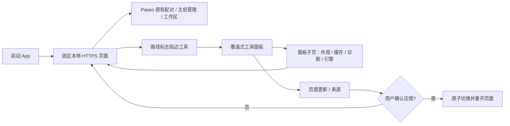
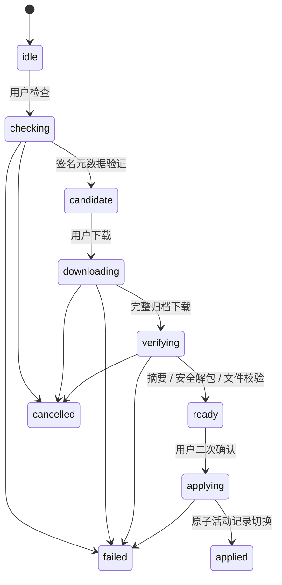

# Paseo Pocket 实现结构

## 页面与原生边界

`MainActivity` 持有一个 `WebSession` 和覆盖在其上的浮动工具。
`FloatingTool` 只处理手势、吸边及归一化位置；工具面板不持有 WebView。
路径标志侧柄沿用原有停靠偏好，仅其触控区域申请系统手势排除。
可见的 26dp 侧柄始终贴合安全区域边缘，不为手势额外向内移动。
部分旧 ROM 不上报侧向手势边距且忽略排除区域，此时仅向内扩展透明触控区；
不改变网页宽度或侧柄外观。红米实测可点击标志，从内侧触控区拖动。
`ToolSheet` 在同一底部面板中管理四格首页和设置子页；`ShellUi` 统一原生配色、字号及控件样式。
夜间模式原位重绘原生界面，子页用当前 Activity 主题创建，避免沿用旧 Dialog 的颜色。
同时更新框架 `android:isLightTheme` 与 WebView 配置，使网页颜色偏好跟随同一次切换。
主题变化由 Activity 处理配置更新，不重建网页。退到后台暂停 WebView 定时器，回到前台恢复。
服务端任务继续由原 Paseo 运行，App 不代替服务端调度任务。

原生容器按系统栏、刘海和 IME 计算内容范围，传给网页的已处理边距清零。
Android 10 的 DisplayCutout 对象也显式清除，避免新 WebView 再次转成 CSS 安全区。
键盘临时夹紧浮钮位置，不覆写键盘收起后的停靠位置。

`WebBundle` 仅把清单中的静态文件映射到 `appassets.androidplatform.net`。
SPA 工作区路由映射到入口 HTML，其他缺失资源返回 404。无静态资源的官网回源。
`PageOrigin` 约束来源、资源路径和恢复路由；恢复位置不保留 query / fragment 中的配对信息。
WebView 不提供原生 JS 桥，禁用文件 URL / 内容 URL 访问与混合内容。
文件选择由系统 Activity Result 返回，外链交给系统，不把 App 做成通用浏览器。

## 状态与目录

| 内容 | 位置 / 归属 |
| --- | --- |
| 内置网页与 npm 信任公钥 | APK assets，构建时生成 |
| 不可变安装包 | App 私有 files/pages/version-digest/ |
| 活动包 / 待应用记录 | 同目录 active.json / pending.json |
| 下载与解包暂存 | 同目录独占随机名称，重启可清理 |
| 配对、Cookie、IndexedDB | 系统 WebView 数据目录，更新模块不写入 |
| 外观、浮钮、来源、上次路由 | App 私有 SharedPreferences |
| 有限事件诊断 | App 私有有界记录，仅显示 / 手动复制 |
| 签名密钥 | 开发机私有目录，不进入源码和 APK |

网页版本固定来源使更新不改变配对存储来源。保留上一完整文件集，但不自动回滚网页数据。
原生进程或 WebView 渲染进程退出均不触发任何会话投递；用户手动重开后检查原会话状态。

## 更新状态机与信任

`PageUpdates` 使用一个生命周期拥有的执行器，进度 UI 至多每 250ms 更新，不轮询网络。
版本子页离开时解除视图绑定，不取消传输；重开时读取当前状态，避免保留已移除的视图。
`HttpsTransport` 限制重定向、超时、元数据和下载大小；取消会断开连接并删除临时归档。
`PackageTrust` 固定包名与 APK 内置 npm 公钥，验证 name@version:integrity 的 ECDSA 签名。
官方和自建源走相同验证链，不因自定义来源放宽信任。

`ArchiveVerifier` 使用流式 SHA-512、受限解压和 Commons Compress，拒绝绝对路径、父目录、
符号 / 硬链接、重复路径、特殊文件和缺少入口依赖。归档上限 64 MiB，展开累计 256 MiB，
单文件 64 MiB，最多 4096 项。只保留网页静态目录及许可，逐文件同步到磁盘。
`BundleStore` 安装到不可变目录，应用前再核对文件 SHA-256，最后原子替换活动记录。
更早版本不允许自动覆盖当前版本；应用失败保留原记录。

## 开放维护边界

App ID、显示名和例子均采用 Paseo Pocket / 中性测试域名，无个人域名或硬编码主机。
用户输入的连接仅由原网页保存。原生设置不维护第二套主机名称或配对协议。
使用 Android 支持的系统 WebView，不内置 Chromium 或自动更改全局引擎。
引擎、宿主、网页、插件和 App 均可独立升级，兼容性需要按组合重新验证。
