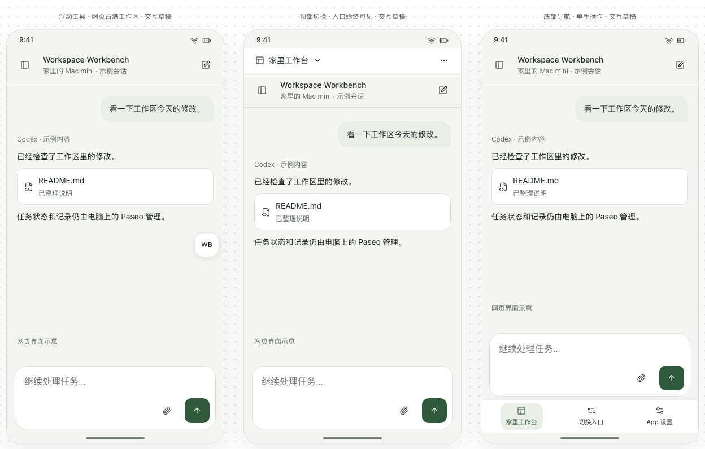
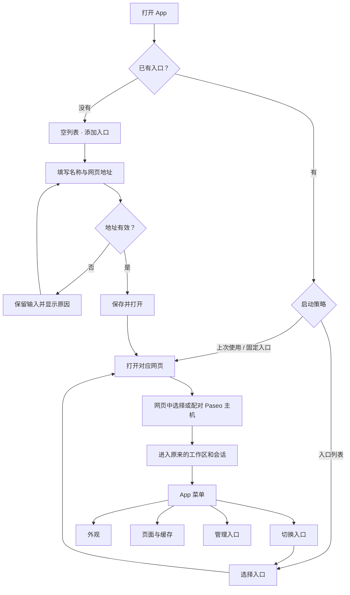
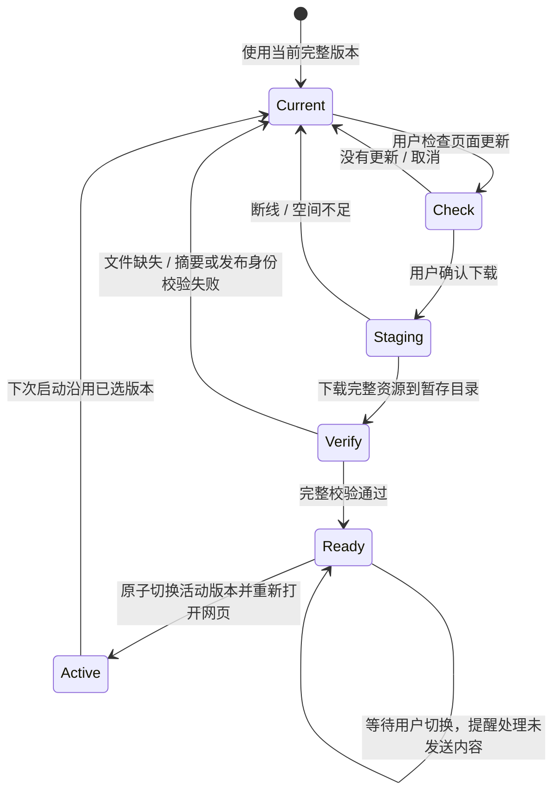

# 安卓薄壳早期交互草案（历史归档）

此目录保留首次讨论时的方案及演示图，**不代表当前 App 的名称、界面或功能边界**。
其中的原生入口列表、重复的主机别名与普通网页缓存方案已被后续决策替代。
当前 Paseo Pocket 0.1.0 直接打开内置网页，沿用网页主机管理；实现与验收见
[Android App 文档](../../../android-app/README.md)。下文保留当时的讨论原貌。

状态：设计讨论稿，2026-10-21。当前交付为可点击草稿、静态图和实施方案；尚未构建 APK。
图中的地址、会话、页面 A / B 均为演示数据，交互不会访问网站或控制真实会话。

## 产品与仓库组织

Workspace Workbench 作为整体工作空间产品维护，Paseo 插件与安卓 App 为同一仓库中的
独立子项目。安卓 App 使用现有 Paseo 网页及 relay，负责入口、外观、系统交互和页面资源。

建议目录如下，实施时逐步增加；本次只增加 `docs/design/android-shell/`：

```text
workspace-workbench/
├── paseo-plugin/                 # 现有插件，保留路径与独立发布流程
├── android-app/                  # 新增：Kotlin + Android WebView
│   ├── app/
│   │   └── src/main/.../
│   │       ├── entries/           # 入口记录、别名、启动策略
│   │       ├── settings/          # 外观、缓存菜单、诊断
│   │       ├── browser/           # 单个活动 WebView、导航与权限
│   │       └── webassets/         # 后续：完整页面资源包
│   └── gradle/libs.versions.toml
├── web-assets/                   # 后续：固定上游版本、生成资源清单与资源包
└── docs/design/android-shell/    # 草稿、流程、验收依据
```

插件、APK、网页资源包分别锁定和记录版本；安卓使用独立 `android-v…` 发布标签。
日常修改某个子项目只运行对应构建，涉及公共契约时再运行相关集成检查。
使用资源包不要求修改电脑上已安装的 Paseo 宿主源码。

## 三种交互方式

可点击草稿为 `workbench-mobile-drafts.html`，在对话内可以切换方案，并通过实际按钮
走入口管理、外观、缓存等流程。预览控制中的“首次打开”可以查看空入口状态。

| 方案 | 工作区中的 App 控件 | 切换入口 | 适用取舍 |
| --- | --- | --- | --- |
| 浮动工具（推荐） | 贴边的小浮钮，点击打开底部面板 | 浮钮 → 切换入口 | 页面空间最多；正式实现支持拖动吸边，避免遮住网页操作 |
| 顶部切换 | 一行入口别名与菜单，无地址栏 | 点击顶部别名 | 当前入口清晰，额外占用一行高度 |
| 底部导航 | 当前工作区、切换入口、App 设置 | 点击底部切换 | 单手操作直观，额外占用底部空间 |

三个方案的入口和设置能力相同。导航方式应在确认草稿后选一种作为首版，避免首版同时
维护三套导航。网页本身的标题栏、侧栏和输入区保持网页职责。



流程草稿图：[首次打开](previews/first-launch.png)、[入口首页](previews/entries.png)、
[添加入口](previews/add-entry.png)、[深色外观](previews/appearance-dark.png)、
[缓存管理](previews/cache.png)、[后续手动更新](previews/page-update.png)。

## 入口、主机与别名

- **网页入口**：App 中保存的名字与网页 URL，例如“家里工作台”。由用户填写；首装列表为空。
- **Paseo 主机**：进入网页后，由网页管理的电脑与 relay 配对记录。网页入口不是 relay URL。
- 一个网页可以连接多台电脑。多个入口也可以指向同一个网页的不同路径。
- App 别名只改变入口列表和 App 菜单的显示，不重命名 Paseo 主机、Workspace 或会话。
- 首版按浏览器 origin 的规则保存网页数据：同源入口共享登录与配对，不承诺同源账号隔离。
  如果后续需要独立账号容器，再评估 WebView 多 Profile 能力与旧设备降级方式。

入口记录包含 `id`、`name`、`url`、创建/最近使用时间；设置保存启动策略及对应入口 ID。
重命名保留 ID。编辑为新站点时，旧站点的配对数据不复制过去。名称可重复，URL 在管理页
提供区分。序列化记录有 schema 版本，迁移保留未知字段。

## 完整使用流程



| 场景 | 用户操作 | 预期结果 |
| --- | --- | --- |
| 首次添加 | 添加入口 → 填别名与 HTTPS 网页地址 → 保存并打开 | 本地保存入口，再打开网页；连接主机在网页内完成 |
| 再次启动 | 默认打开上次入口 | 不必重复填地址；上次入口被移除则回入口列表 |
| 改启动方式 | App 设置 → 下次启动时 | 上次入口 / 入口列表 / 已设置的默认入口 |
| 多入口切换 | App 菜单或切换控件 → 选择别名 | 当前 WebView 退场，新入口打开；电脑上的 Agent 继续运行 |
| 重命名 | 入口首页 → 入口菜单 → 编辑 | 保存后显示新别名，保留入口身份 |
| 移除 | 入口菜单 → 移除 → 确认 | 仅移除快捷入口；网页数据与服务器会话单独管理 |
| 切主题 | 外观 → 跟随系统 / 明亮 / 深色 | App 立即切换；网页主题同步存在下述边界 |
| 清理资源缓存 | 页面与缓存 → 清理并重新加载 → 确认 | 保留登录和配对；提醒先处理未发送内容 |
| 页面加载失败 | 展示错误与重试 / 返回入口列表 | 不反复创建 WebView，也不自动重发用户消息 |
| WebView 渲染进程退出 | 展示恢复页，由用户重新打开 | 重新建立界面连接，不重放任务 |
| 返回手势 | 先关闭 App 面板，再返回网页历史 | 网页没有可返回历史时，回入口列表；入口列表再次返回退出 |

首版只保留一个活动 WebView。切换入口时处理其生命周期、结束旧页面连接，不预热或
后台保留多个完整页面。系统恢复 Activity 时保留入口和可恢复网页状态；不把打开设置
或显示菜单实现成重新加载网页。输入草稿能否跨页面重载恢复取决于网页，不作无依据保证。

## 沉浸式显示与主题

默认使用 edge-to-edge，状态栏、手势区和页面背景连续；保留系统时间、网络和电量。
可交互内容避开刘海、系统手势和输入法区域。旧设备使用兼容实现，测试手势导航与三键导航。
这与隐藏全部系统栏分别设置，首版不要求永久隐藏系统栏。
参见 [Android edge-to-edge](https://developer.android.com/develop/ui/views/layout/edge-to-edge)。

主题分为 App 原生界面与网页两层。App 支持跟随系统、明亮和深色；WebView 通过
`prefers-color-scheme` 向网页表达外观。Paseo 网页如已单独选择主题，其设置可能优先；
先使用网页“跟随系统”，自托管前端后续再加明确的主题通信接口。普通任意网页不保证
可被 Android 设置强制改色，也不采用整页颜色反转。
参见 [WebView 深色主题](https://developer.android.com/develop/ui/views/layout/webapps/dark-theme)。

## 缓存与手动页面更新

用户的理解在**静态前端资源**这一层成立：HTML、JS、CSS、字体、图标以及懒加载模块
可以整体保存。页面显示的会话、文件、终端、主机状态与 WebSocket 不因此离线可用。
只抓一次首页或预热几个请求，无法证明所有按需模块都已完整保存。

### 首版：普通网页缓存

- 使用 WebView HTTP 资源缓存并尊重网站缓存规则。允许用户输入不同网页地址。
- 提供重新加载、清理资源缓存并重新加载；配对、Cookie、localStorage、IndexedDB
  与资源缓存分开管理，普通清理不清除它们。
- 普通资源缓存可被系统回收，资源过期后可能联网更新，因此**不是固定版本或永久离线包**。
- 如网页后续使用 Service Worker，需单独确认 Cache Storage 的更新与清理，不能把
  `WebView.clearCache(true)` 当成清除一切网页缓存。
- 整个应用的 WebView HTTP 缓存可能共享；普通清理不能标为“只清当前入口”。首版按钮
  明确清理 App 网页资源缓存，后续版本化资源包可以按入口或包 ID 管理。

参见 [WebSettings 缓存模式](https://developer.android.com/reference/android/webkit/WebSettings#LOAD_DEFAULT)
与 [WebView.clearCache](https://developer.android.com/reference/android/webkit/WebView#clearCache(boolean))。

### 后续：完整资源包与手动切版

从明确版本的 Paseo Web 前端构建产物导出资源包及清单，包含全部懒加载 chunk、字体、
Worker/WASM 等实际引用的本地文件。记录上游 tag/commit、Workbench 打包修订、资源
大小及摘要、测试过的宿主兼容版本。保留上游许可和声明。

完整资源包来自我们维护的发布源；普通任意网址仍可使用 HTTP 缓存，不假定任意网站都
提供可验证、可重打包的完整静态前端。官方 `app.paseo.sh` 可作为网页入口；需要固定
整套版本时，以其明确构建产物或上游源码构建为依据，而不是对运行中的站点做盲目抓取。



- 下载和校验在后台完成，失败不破坏当前版本；只有用户确认切换时才重载界面。
- 已安装包放在 App 持久文件目录，不把系统可回收的缓存目录作为唯一副本。
- 优先保留当前包与上一完整包，按内容摘要去重复用资源，清理中断的暂存目录。
- 清理临时缓存与删除已安装页面版本分别提供；清理临时缓存不能让固定版本悄悄换版。
- 资源回退不回滚网页数据。只有已验证网页存储格式向后兼容，才提供直接回退；否则
  保留旧资源供诊断，提示兼容限制。
- 默认只在用户操作时检查、下载和切换，不以轮询产生持续客户端负载。

加载方式需先做兼容验证：在所选网页的 HTTPS origin 上，仅对完整清单中确定为静态的
GET 请求返回已校验本地内容，保留原 origin 与路径语义；API、WebSocket、动态文件和
第三方导航仍走网络。不得把接口失败伪装成静态首页。
还要验证 SPA 路由、懒加载、Worker、CSP、Service Worker 和接口自动发现。
若该前端不适合同源静态拦截，可评估 WebViewAssetLoader 的本地 HTTPS origin，但必须
显式适配宿主发现、存储 origin 与链接行为，再决定是否采用。
参见 [Android 本地网页资源](https://developer.android.com/develop/ui/views/layout/webapps/load-local-content)。

## 技术基线与兼容

按 2026-10-21 查到的稳定发行制定，开始写 APK 时再次确认并固定依赖，不使用动态 `+`：

| 项目 | 初步基线 | 依据 / 限制 |
| --- | --- | --- |
| 实现 | Kotlin + AndroidX + 单个系统 WebView | 原生部分只负责壳与设置，不引入整套 React Native 运行时 |
| 构建 | AGP 9.4.0、Gradle 9.6.0、JDK 17 | [官方兼容表](https://developer.android.com/build/releases/agp-9-4-0-release-notes)；Kotlin 使用构建工具配套方案 |
| SDK | compile / target API 37 | [Android 17 SDK](https://developer.android.com/about/versions/17/setup-sdk)；行为变化需在实机 / 模拟器验证 |
| WebView 兼容库 | AndroidX WebKit 1.17.1 | [稳定版本](https://developer.android.com/jetpack/androidx/releases/webkit)，不选 1.18 RC |
| 旧系统 | 建议最低 Android 8 / API 26 | 这是初步产品范围，并非系统库的最低要求；具体更旧需求可再收敛 |
| 旧 WebView | 运行时检测必要能力 | Android 版本可安装不等于陈旧 WebView 能运行当前网页或 E2EE；缺能力时给出原因和系统 WebView 更新入口 |

Android 8–9 没有与新系统相同的全局深色设置，跟随系统采用兼容默认值，用户仍可手动选
明亮或深色。不支持的新 WebView 扩展能力按 feature 检测关闭，不能仅比较 Android API。
当前 vivo Android 16 与系统 WebView 155 可用于实机验证，但它不是旧系统验证的替代。

只对配置中的受信任页面开放少量桥接动作，如主题同步、文件选择、诊断导出。外部链接
交给外部浏览器，不把 App 原生接口暴露给任意跳转页面。首版使用 HTTPS 入口，保留证书
校验；内网 HTTP 如确有需求，后续再按站点明确支持并验证安全上下文所需能力。

## 分阶段交付与验收

**阶段一：薄壳 APK。** 确认一种导航后，在本仓库增加 `android-app/`，实现入口增删改、
别名、启动策略、单 WebView、沉浸式、外观、返回/键盘、文件选择、普通缓存与只读诊断。
已有插件继续按原目录维护。当前草稿中的资源包更新页面是下一阶段预览，不属于首版已实现能力。

**阶段二：手动页面版本。** 增加 `web-assets/`，首先支持我们维护的 Paseo Web 构建，
完成资源清单、发布校验、暂存下载、原子切换、持久副本与受限回退，再扩展其他页面来源。

**阶段三：按实际需求补原生能力。** 例如配对链接接收、相机扫码、下载、语音权限与
后台通知。后台持续收消息不由一个常驻 WebView 自然保证，需要单独设计。

验证至少覆盖以下内容：

1. 零预置地址；中文别名；新增/编辑/移除/默认入口；冷启动、Activity 恢复、进程重启；
   同源网页数据共享；删除入口不删除真实主机/会话。
2. Android 8、10、13、16、17 的模拟器或实机矩阵；新旧 WebView 能力；刘海、横屏、
   手势/三键导航、输入法、返回行为和原生/网页主题组合。
3. 同一网页、同一会话、同一插件状态下，对比 Chrome 与 APK 的首开/热开、长记录滚动、
   入口切换后内存是否回落、前后台 CPU、温度及渲染进程退出。不预先承诺与 Chrome 一样快。
4. 普通缓存清理不丢配对；Service Worker 边界；固定包完整性；断网、下载中断、空间不足、
   校验失败、切换途中进程死亡；更新不重放用户操作。
5. App 构建、lint、相关 JVM/设备测试；前端资源包的脚本测试和实际 WebView 集成验证。
   改动插件时才运行对应插件检查。本轮只有设计文件，不把桌面草稿验证描述为安卓 APK 验证。

## 本轮草稿验证

静态图位于 `previews/`。本地 Chromium + Playwright 检查通过：三种导航、打开菜单时
保留示例草稿、地址校验与保留输入、新增/默认/编辑/移除入口、切换入口、明亮/深色、
启动选项、缓存清理确认、演示资源包更新成功/失败、320px 窄屏、空列表与无预置地址。
未捕获页面脚本错误；插件 TypeScript 检查通过。原始检查结果保存在
`/tmp/workbench-mobile-drafts-verification.json`。

本轮仅验证桌面浏览器中的设计交互，没有构建 APK，也没有验证 Android WebView 的
真实性能、真实资源缓存、离线加载、下载更新或主机/relay 连接。
